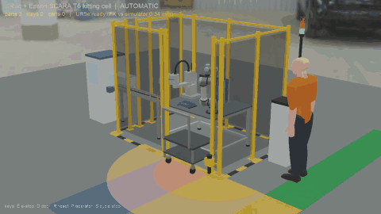
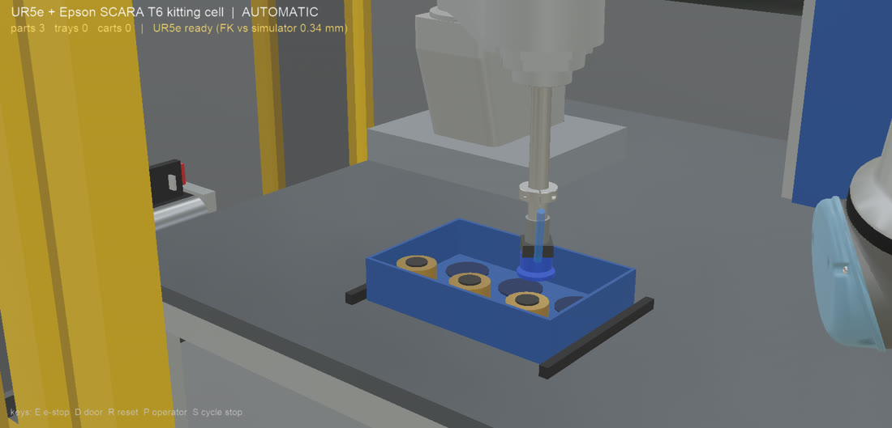
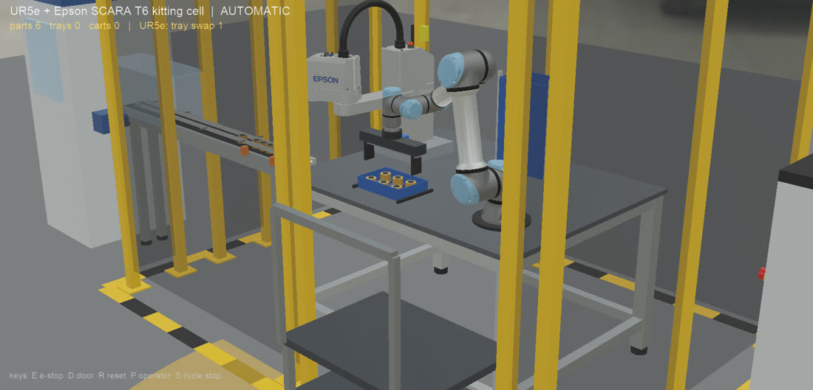
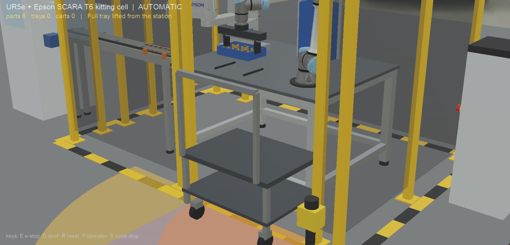
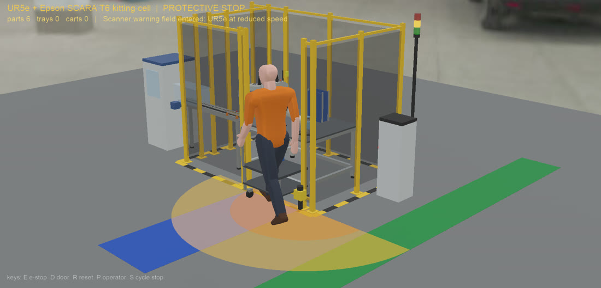
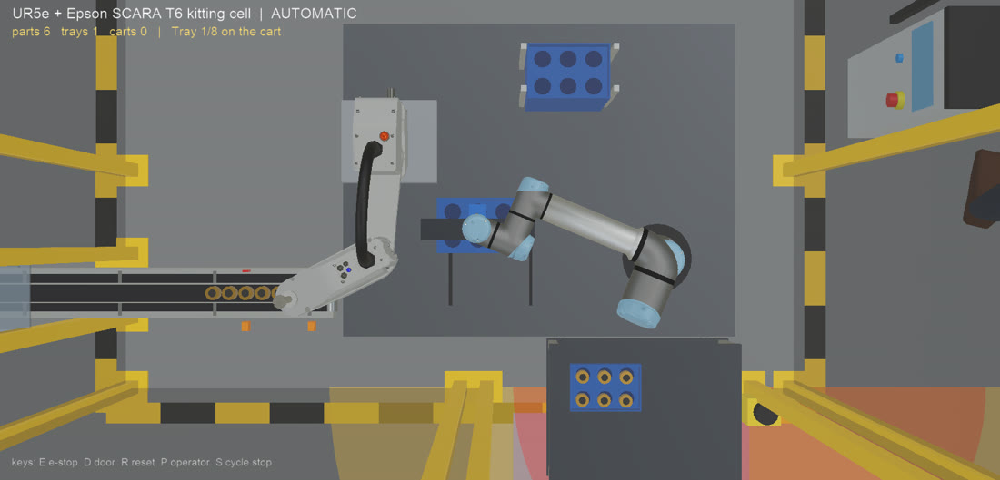

# UR5e + Epson SCARA kitting cell (Webots R2025a)

[](https://github.com/sergiudanstan/ur-scara-cell-webots/actions/workflows/ci.yml)
[](https://github.com/sergiudanstan/ur-scara-cell-webots/actions/workflows/codeql.yml)
[](https://scorecard.dev/viewer/?uri=github.com/sergiudanstan/ur-scara-cell-webots)
[](LICENSE)

**Live:** https://sergiudanstan.github.io/ur-scara-cell-webots/

This is a robot cell where two robots work together.
- An infeed conveyor brings round parts to a stop.
- An **Epson SCARA T6-602S** places six parts in each tray.
- A **UR5e** cobot replaces each full tray with an empty one: the full tray goes onto an outfeed cart and the empty one comes from a magazine.
- When the cart holds 2 × 2 × 2 trays, it leaves through an opening guarded by an area scanner and comes back empty.

**▶ [Interactive 3D animation in the browser](https://sergiudanstan.github.io/ur-scara-cell-webots/)** shows one full cycle, including the cart trip. It runs on GitHub Pages, so you don't need Webots.
**▶ [Cycle video (MP4, 60 s)](https://github.com/sergiudanstan/ur-scara-cell-webots/releases/tag/v1.0)** is attached to the v1.0 release.



| SCARA placing a part in the tray | UR5e taking the full tray |
|---|---|
|  |  |
| **Tray on the outfeed cart** | **Operator in the scanner fields: protective stop** |
|  |  |

## Run it

```
webots worlds/ur_scara_cell.wbt
```

The controllers are plain Python 3 with no extra packages. Webots downloads the robot models from the official
R2025a library the first time it runs.

## Layout



All dimensions are in [`lib/layout.py`](lib/layout.py), and the world generator, the PLC and both robot controllers read them from there.
To change the layout, edit that file and run `python3 tools/gen_world.py`.

| Item | Model |
|---|---|
| SCARA | `ScaraT6Cell` ([`protos/`](protos/ScaraT6Cell.proto)) is the official Webots Epson T6-602S model. The only change is that the J1/J2 limits use the datasheet values (±132° / ±150°) instead of the demo calibration (±42° / ±48°), which left only a 5 cm wide workspace. |
| Cobot | `UR5e` (official Webots model), with a tray gripper built for this project: two fingers driven by real `LinearMotor`s. |
| SCARA tool | Bellows suction cup on the shaft |
| Parts / trays | Ø44 × 35 mm parts and 240 × 160 × 50 mm trays with 6 pockets. The parts and trays are pre-created pools, so the HTML5 export can contain them. |
| Cell | Aluminium work table, belt conveyor with side guides and an end stop, a feeder machine, a mesh guard fence with a door, a magazine for empty trays, an outfeed cart, an operator console, a stack light, and an area scanner. |

## Cycle

1. The **conveyor** carries parts at 0.3 m/s, and they queue up behind the end stop.
   **B1** detects a part at the stop. **B5** detects that the queue is full, which pauses the feeder.
2. The **SCARA** (when **B2** shows a tray at the station and the tray is not full) moves vertically down onto the part, turns the vacuum on, lifts it to the transfer height and places it in the next pocket.
   It then waits above the pick point, which keeps the station clear for the UR5e.
3. The **UR5e** (when the tray is full, **B7** shows the cart docked and the SCARA is clear) runs the tray swap:
   station → cart slot *k* → top of the magazine → station → home.
4. When the **cart is full**, it leaves through the opening.
   Outside the cell an operator empties the trays and refills the magazine, then the cart docks again.

## Safety

| Device | Effect |
|---|---|
| Guard fence with a door interlock | Opening the door stops everything and latches a fault. You must close the door and press **R** to reset. |
| Tunnel over the conveyor entry | Prevents reaching the SCARA through the conveyor opening (ISO 13857). |
| Emergency stop | All robots hold, the belt and cart stop, and a fault is latched. **R** is refused while the e-stop is still pressed. |
| Area scanner at the cart opening (speed and separation monitoring) | Each field is a half disc outside the fence. In the **warning field (1.6 m)** the UR5e drops to 25 % speed and the SCARA to 50 %. In the **protective field (0.9 m)** the robots hold (category 2 stop), and they restart automatically 1.5 s after the field is clear. |
| Stack light | Green = automatic, amber = warning, stopped or end-of-cycle stop, flashing red = fault. |

## Keys (click in the 3D view first)

| Key | Action |
|---|---|
| `E` | Press / release the emergency stop |
| `D` | Open / close the guard door |
| `R` | Reset |
| `P` | Operator walks to the cart opening and back |
| `S` | End-of-cycle stop / restart |

A script can send the same letters by writing them into the `customData` field of the `cell PLC` robot.

## Software

```
lib/layout.py                     shared layout (single source of truth)
lib/motion.py                     motion executor: joint moves, linear moves with IK at each step (quintic profile),
                                  actions, hold (cat. 2 stop) and speed override; kinematic grasping
controllers/cell_plc/             PLC (supervisor). CONTROL decisions use only the sensors (B1/B2/B5/B7, scanner) and
                                  robot events. PROCESS part simulates the belt, cart, door and magazine refill.
controllers/scara_robot/          SCARA controller + scara_kin.py (closed-form IK/FK read from the PROTO chain)
controllers/ur_robot/             UR5e controller + ur5e_kin.py (FK = PROTO chain, damped-least-squares IK, tool down)
controllers/operator/             walking operator (Pedestrian PROTO)
controllers/animation_recorder/   HTML5 export,   controllers/media_recorder/  stills and video
tools/gen_world.py                generates worlds/ur_scara_cell.wbt
tools/build_site.sh               HTML5 animation -> site/ (GitHub Pages, gh-pages branch)
tools/build_media.sh              stills -> docs/, video -> ~/Downloads/ur-scara-cell
tests/test_kinematics.py          offline: IK/FK round trips, reachability of every target, full UR swap program
tests/run_smoke.sh                headless Webots run of 330 s with scripted safety events (PASS/FAIL)
```

The PLC talks to the robots in JSON over Emitter/Receiver radios: channels 1/2 for the SCARA, 3/4 for the UR5e and 5 for the operator.

## Tests

```
python3 -m pytest tests                 # offline, ~8 s
tests/run_smoke.sh                      # Webots headless, ~20 s wall time
```

The smoke test runs a full cycle and checks the following:
- At least 8 trays reach the cart and the cart makes a full trip.
- Neither robot reports an error.
- For each robot, its own FK (mapped to the world frame) is within 2 mm of the TCP position measured by the simulator. The measured errors are 0.23 mm for the SCARA and 0.34 mm for the UR5e.
- The e-stop holds the robots, a reset is refused while the e-stop is pressed, and the scanner both stops the robots and restarts them automatically.

## Development

`python3 -m pytest -q tests` runs the offline kinematics tests without Webots. CI runs them together with a compile check of every Python file and a check that `worlds/ur_scara_cell.wbt` equals the output of `tools/gen_world.py`. The headless Webots smoke test (`tests/run_smoke.sh`) needs a Webots installation and is not run in CI. See [CONTRIBUTING.md](CONTRIBUTING.md) for branches and releases, [SECURITY.md](SECURITY.md) for reporting vulnerabilities, and [CHANGELOG.md](CHANGELOG.md) for history.

## Credits

- The layout of the project was inspired by [NicolasBrochen/palletizer-cell-webots](https://github.com/NicolasBrochen/palletizer-cell-webots), which uses the same ideas: a parametric world generator, a PLC supervisor separating control from the simulated process, analytic IK, and an HTML5 export on Pages. The code in this repository was written from scratch.
- The robot models are the Cyberbotics Webots R2025a library (Apache 2.0). `protos/ScaraT6Cell.proto` is derived from `ScaraT6.proto`, and its header lists the changes.
